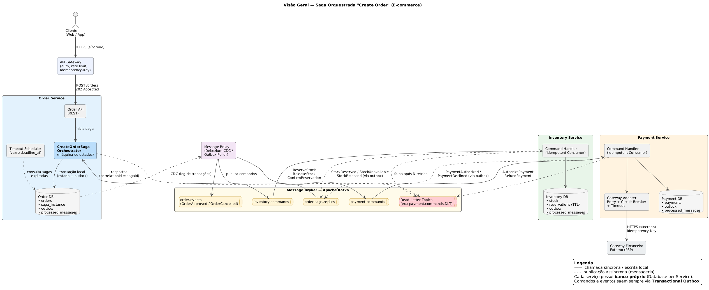
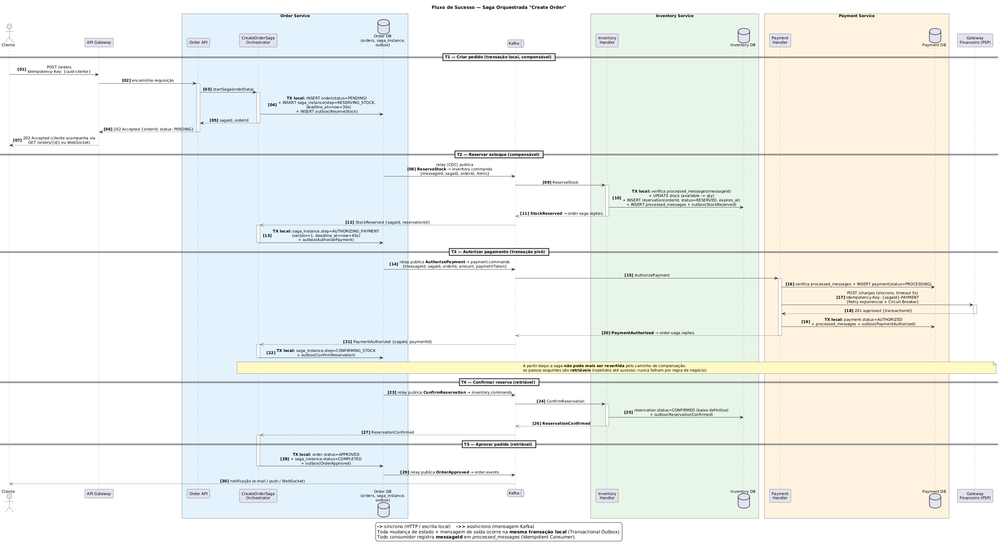
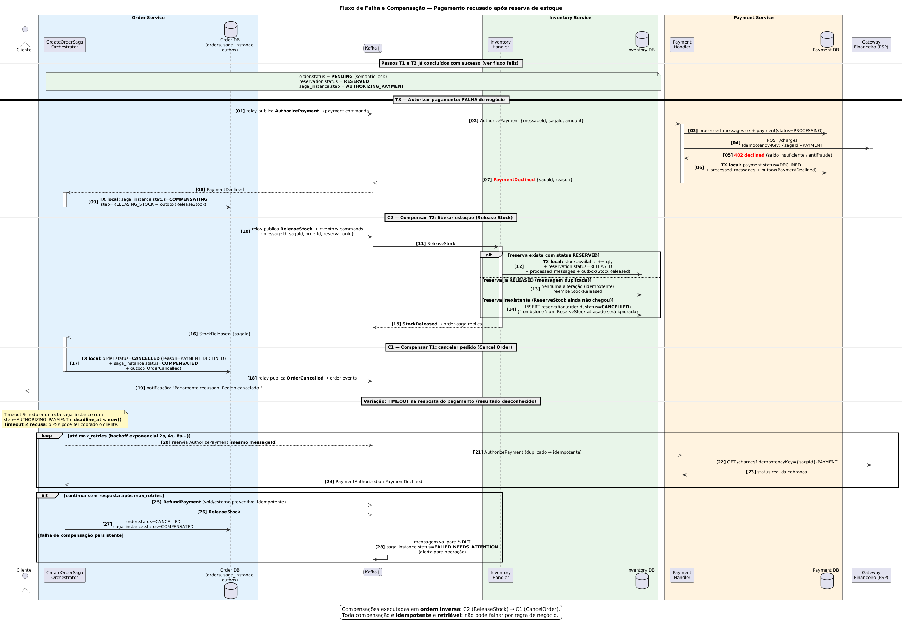
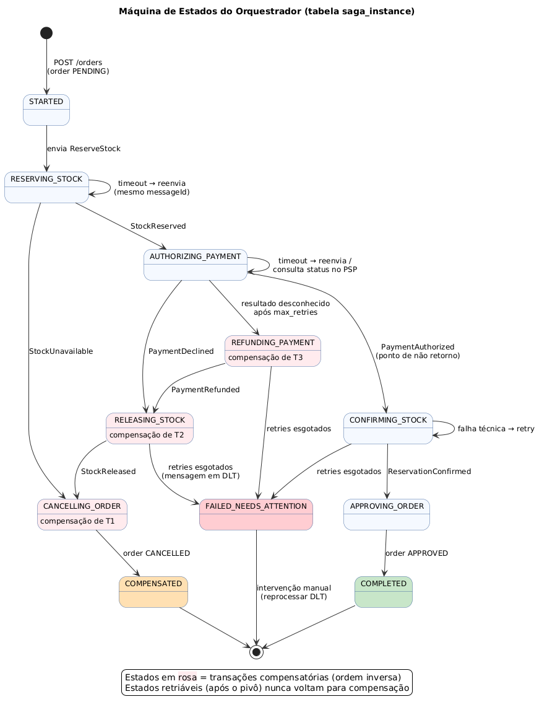

# Blueprint de Arquitetura — Padrão Saga no Checkout de E-commerce

> Atividade prática de arquitetura: desenho e modelagem do **padrão Saga** para o fluxo de compra de um e-commerce migrado de monólito para microsserviços.
> Referência principal: [Pattern: Saga — microservices.io](https://microservices.io/patterns/data/saga.html)

## Sumário

1. [Contexto de negócio](#1-contexto-de-negócio)
2. [Problema arquitetural](#2-problema-arquitetural)
3. [Decisão: Saga Orquestrada vs. Coreografada](#3-decisão-saga-orquestrada-vs-coreografada)
4. [Transações da Saga e suas compensações](#4-transações-da-saga-e-suas-compensações)
5. [Diagramas](#5-diagramas)
6. [Matriz de decisão e idempotência](#6-matriz-de-decisão-e-idempotência)
7. [Tabela de controle de estado da Saga e timeouts](#7-tabela-de-controle-de-estado-da-saga-e-timeouts)
8. [Estrutura do repositório](#8-estrutura-do-repositório)
9. [Como editar e regenerar os diagramas](#9-como-editar-e-regenerar-os-diagramas)
10. [Referências](#10-referências)

---

## 1. Contexto de negócio

A empresa está migrando seu monólito de comércio eletrônico para uma arquitetura de microsserviços. O fluxo mais crítico — **a compra** — passa a envolver três domínios desacoplados, cada um com **seu próprio banco de dados** (*Database per Service*):

| Serviço | Responsabilidade | Dados que possui |
|---|---|---|
| **Order Service** | Registrar e gerenciar o ciclo de vida do pedido. Hospeda o orquestrador da Saga. | `orders`, `saga_instance`, `outbox`, `processed_messages` |
| **Inventory Service** | Gerenciar estoque e realizar **reservas temporárias** (com expiração). | `stock`, `reservations`, `outbox`, `processed_messages` |
| **Payment Service** | Processar pagamentos junto ao **gateway financeiro externo (PSP)**. | `payments`, `outbox`, `processed_messages` |

**Requisitos de negócio relevantes**

- Um pedido só pode ser **aprovado** se houver estoque reservado **e** pagamento autorizado.
- Se qualquer etapa falhar, o sistema deve **desfazer automaticamente** o que já foi feito (liberar estoque, cancelar pedido, estornar pagamento se necessário).
- O cliente não pode ser cobrado sem receber o produto, nem o estoque pode ficar "preso" em pedidos mortos.
- Picos de tráfego (Black Friday) exigem que o fluxo seja **assíncrono e escalável horizontalmente**.

## 2. Problema arquitetural

Com bancos independentes, **não existe uma transação ACID única** que abranja pedido, estoque e pagamento. O *Two-Phase Commit* (2PC/XA) foi descartado porque:

- bloqueia recursos de vários serviços enquanto aguarda o coordenador (baixa disponibilidade);
- não é suportado por brokers modernos (Kafka) nem por gateways de pagamento externos;
- acopla temporalmente todos os serviços (se um cai, todos travam).

**Solução:** o padrão **Saga** — uma sequência de **transações locais**, em que cada uma atualiza o banco do seu serviço e dispara o próximo passo por mensagem. Se um passo falhar por regra de negócio, a Saga executa **transações compensatórias** que desfazem os passos anteriores, em **ordem inversa**. O resultado é **consistência eventual** em vez de consistência imediata.

## 3. Decisão: Saga Orquestrada vs. Coreografada

### 3.1 Opções avaliadas

- **Coreografia:** não há coordenador. Cada serviço publica eventos de domínio (`OrderCreated`, `StockReserved`...) e os demais reagem a eles.
- **Orquestração:** um **orquestrador central** (`CreateOrderSaga Orchestrator`) envia **comandos** a cada participante e reage às **respostas**, mantendo o estado da Saga persistido.

### 3.2 Comparação por atributo de qualidade

| Critério | Coreografia | Orquestração | Vencedor |
|---|---|---|---|
| **Acoplamento** | Serviços acoplados aos *eventos* uns dos outros; risco de dependências cíclicas (Order ↔ Inventory ↔ Payment). | Participantes conhecem apenas seus próprios comandos/respostas; só o orquestrador conhece o fluxo. Sem ciclos. | Orquestração |
| **Complexidade / entendimento do fluxo** | Lógica espalhada em vários serviços; difícil responder "em que passo está o pedido X?". | Fluxo explícito em uma **máquina de estados** única, fácil de ler, testar e versionar. | Orquestração |
| **Compensação** | Cada serviço precisa saber quando e como compensar; difícil garantir ordem inversa. | O orquestrador dispara as compensações na ordem correta. | Orquestração |
| **Timeouts e falhas de rede** | Ninguém "espera" por uma resposta: um evento perdido deixa a Saga parada silenciosamente. | Tabela `saga_instance` com `deadline_at`: o orquestrador **detecta** a falta de resposta e age. | Orquestração |
| **Observabilidade e auditoria** | Exige rastreamento distribuído para reconstruir o fluxo. | Estado atual e histórico de cada Saga em uma tabela consultável. | Orquestração |
| **Escalabilidade** | Excelente — nenhum componente central. | Boa — o orquestrador é *stateless* em memória (estado no banco) e escala horizontalmente com particionamento por `sagaId`. | Coreografia (pequena vantagem) |
| **Ponto único de falha** | Não há. | Mitigado: várias instâncias do orquestrador, estado durável, Kafka com replicação. | Coreografia (mitigável) |
| **Evolução (novos passos, ex.: antifraude, frete)** | Exige alterar vários serviços e reavaliar a cadeia de eventos. | Novo passo = novo estado na máquina de estados + novo participante. | Orquestração |

### 3.3 Decisão

> **Adotamos Saga Orquestrada**, com o orquestrador `CreateOrderSaga` hospedado no **Order Service** (dono do agregado `Order`), comunicando-se com os participantes de forma **assíncrona via Apache Kafka** (canais de comando e de resposta) e publicando mensagens através do padrão **Transactional Outbox**.

**Justificativa resumida:** o fluxo de compra tem **etapas com ordem rígida**, uma **transação pivô** externa (pagamento) e exigências fortes de **compensação e tratamento de timeout**. Esses fatores tornam a visibilidade central do estado mais valiosa do que a pequena vantagem de escalabilidade da coreografia. A coreografia continua sendo usada para **eventos de integração finais** (`OrderApproved`, `OrderCancelled`) consumidos por serviços periféricos (notificação, analytics, logística), que não participam da Saga.

Detalhes, riscos e trade-offs estão em [`docs/decisoes-arquiteturais.md`](docs/decisoes-arquiteturais.md).

## 4. Transações da Saga e suas compensações

| # | Transação (serviço) | Tipo | Comando / Resposta | Transação compensatória |
|---|---|---|---|---|
| T1 | Criar pedido `PENDING` (Order) | Compensável | — (local) | **C1 – Cancel Order** → `order.status = CANCELLED` |
| T2 | Reservar estoque (Inventory) | Compensável | `ReserveStock` → `StockReserved` / `StockUnavailable` | **C2 – Release Stock** → `ReleaseStock` → `StockReleased` |
| T3 | Autorizar pagamento (Payment + PSP) | **Pivô** | `AuthorizePayment` → `PaymentAuthorized` / `PaymentDeclined` | **C3 – Refund Payment** (só no caso de resultado desconhecido por timeout) |
| T4 | Confirmar reserva / baixa definitiva (Inventory) | Retriável | `ConfirmReservation` → `ReservationConfirmed` | — (não falha por regra de negócio; repete até sucesso) |
| T5 | Aprovar pedido (Order) | Retriável | — (local) | — |

- **Compensável:** pode ser desfeita.
- **Pivô:** ponto de decisão — se tiver sucesso, a Saga obrigatoriamente vai até o fim.
- **Retriável:** acontece depois do pivô e é garantida por repetição (não há compensação).

As compensações são executadas em **ordem inversa** (C3 → C2 → C1) e são todas **idempotentes**.

## 5. Diagramas

Todos os diagramas foram feitos em **PlantUML** (arquivo editável `.puml`) e exportados em **PNG** e **SVG** na pasta [`/diagrams`](diagrams).

### 5.1 Visão geral da arquitetura — `saga-architecture-overview.png`



**Descrição:** o cliente chama o **API Gateway** (síncrono, HTTPS) que encaminha ao **Order Service**. O Order Service responde imediatamente `202 Accepted` e o **orquestrador** grava, na mesma transação local, o pedido, o estado da Saga e a mensagem de comando na tabela **outbox**. O **Message Relay** (Debezium CDC) lê a outbox e publica no **Kafka**, nos tópicos `inventory.commands` e `payment.commands`. Os participantes processam os comandos como **Idempotent Consumers**, gravam no seu próprio banco e respondem no tópico `order-saga.replies`, correlacionado pelo `sagaId`. O **Payment Service** é o único que faz chamada síncrona externa (ao PSP), protegida por **Timeout + Retry + Circuit Breaker**. Mensagens que esgotam as tentativas vão para os **Dead-Letter Topics** (`*.DLT`). O **Timeout Scheduler** varre sagas com `deadline_at` vencido.

### 5.2 Fluxo de sucesso — `sequence-success-flow.png`



**Descrição passo a passo:**

1. **[01–07] T1 – Criar pedido (síncrono):** `POST /orders` com `Idempotency-Key`. Em uma única transação local, o Order Service cria o pedido `PENDING`, a linha em `saga_instance` (passo `RESERVING_STOCK`, com `deadline_at`) e o comando `ReserveStock` na outbox. Retorna **202 Accepted** — o cliente não fica bloqueado esperando a Saga.
2. **[08–13] T2 – Reservar estoque (assíncrono):** o relay publica `ReserveStock`; o Inventory verifica `processed_messages`, decrementa o disponível, cria a reserva com expiração e responde `StockReserved`. O orquestrador avança para `AUTHORIZING_PAYMENT`.
3. **[14–22] T3 – Autorizar pagamento (pivô):** o Payment Service chama o PSP de forma **síncrona** com `Idempotency-Key = {sagaId}-PAYMENT`, protegido por retry e circuit breaker, e responde `PaymentAuthorized`. **A partir daqui a Saga não volta atrás.**
4. **[23–27] T4 – Confirmar reserva (retriável):** o estoque reservado vira baixa definitiva.
5. **[28–30] T5 – Aprovar pedido (retriável):** `order.status = APPROVED`, `saga_instance.status = COMPLETED` e o evento `OrderApproved` é publicado para notificação/logística.

### 5.3 Fluxo de falha e compensação — `sequence-compensation-flow.png`



**Descrição:** cenário exigido pela atividade — o **Payment Service recusa o pagamento depois que o Inventory já reservou o produto**.

1. **[01–07]** O PSP responde `402 declined`. O Payment Service grava `DECLINED` e responde `PaymentDeclined`.
2. **[08–09]** O orquestrador muda a Saga para **`COMPENSATING`** e grava o comando `ReleaseStock` na outbox.
3. **[10–16] C2 – Release Stock:** o Inventory devolve a quantidade ao estoque e marca a reserva como `RELEASED`. O bloco `alt` mostra que a compensação é idempotente: se a mensagem chegar duplicada, nada muda; se a reserva **ainda não existir** (o `ReserveStock` está atrasado na rede), é criado um registro *tombstone* `CANCELLED` que fará o `ReserveStock` atrasado ser ignorado.
4. **[17–19] C1 – Cancel Order:** o pedido vai para `CANCELLED`, a Saga para `COMPENSATED` e o cliente é notificado.
5. **[20–28] Variação – timeout do pagamento:** sem resposta até o `deadline_at`, o orquestrador **não assume falha** (o PSP pode ter cobrado). Ele reenvia o comando com o **mesmo `messageId`** e o Payment consulta o status real no PSP pela chave de idempotência. Se após `max_retries` o resultado continuar desconhecido, a Saga compensa também o pagamento (`RefundPayment`, idempotente). Se uma compensação falhar repetidamente, a mensagem vai para a **DLT** e a Saga fica `FAILED_NEEDS_ATTENTION`, gerando alerta para a operação.

### 5.4 (Extra) Máquina de estados do orquestrador — `saga-state-machine.png`



Mostra todos os estados persistidos na tabela `saga_instance`, as transições de sucesso, as transições de compensação (em rosa), os laços de retry por timeout e o estado terminal de exceção `FAILED_NEEDS_ATTENTION`.

## 6. Matriz de decisão e idempotência

Como o Kafka entrega mensagens **pelo menos uma vez** (*at-least-once*), todo consumidor pode receber a mesma mensagem mais de uma vez (reentrega após rebalance, retry do produtor, reenvio do orquestrador por timeout). A tabela abaixo define, para cada operação, **como a duplicata é detectada e qual o efeito**.

| Operação | Chave de idempotência | Mecanismo | Se chegar duplicada | Se chegar fora de ordem |
|---|---|---|---|---|
| `POST /orders` (cliente) | Header `Idempotency-Key` | Tabela `idempotency_keys` no Order Service (resposta salva por 24h) | Retorna o mesmo `orderId` e `202`, sem criar novo pedido | n/a |
| Qualquer comando/resposta | `messageId` (UUID gerado na outbox) | **Idempotent Consumer**: `INSERT INTO processed_messages(consumer, message_id)` na **mesma transação** da mudança de negócio (PK única) | Violação de PK → transação descartada, apenas faz *ack* | n/a |
| `ReserveStock` | `orderId` (UNIQUE em `reservations`) | Chave de negócio + `processed_messages` | Reserva já existe → reenvia `StockReserved` | Se existe *tombstone* `CANCELLED` → ignora e responde `StockReleased` |
| `ReleaseStock` (compensação) | `orderId` | Transição de estado só `RESERVED → RELEASED` | Já `RELEASED` → sem efeito, reenvia `StockReleased` | Reserva inexistente → cria *tombstone* `CANCELLED` |
| `ConfirmReservation` | `orderId` | Transição só `RESERVED → CONFIRMED` | Já `CONFIRMED` → sem efeito | n/a (só ocorre após `PaymentAuthorized`) |
| `AuthorizePayment` | `{sagaId}-PAYMENT` | `processed_messages` + `Idempotency-Key` no PSP | PSP devolve a **mesma cobrança**, nunca cobra duas vezes | n/a |
| `RefundPayment` (compensação) | `{sagaId}-REFUND` | `Idempotency-Key` no PSP + estado `AUTHORIZED → REFUNDED` | Sem efeito | Se pagamento nunca foi criado → registra `REFUNDED` vazio (no-op) |
| Respostas ao orquestrador | `sagaId` + `step` esperado + `version` | **Optimistic locking** em `saga_instance` e validação de estado | Resposta para um passo já concluído é descartada | Resposta de passo antigo (após timeout) é registrada em log e descartada |

**Regras gerais:**

- Toda mudança de estado de negócio e toda mensagem de saída são gravadas **na mesma transação local** (Transactional Outbox) — nunca há "gravou no banco mas não publicou" ou vice-versa.
- Transições de estado são escritas como **`UPDATE ... WHERE status = <estado_esperado>`**: uma reentrada simplesmente afeta 0 linhas.
- **Compensações não podem falhar por regra de negócio** — só por falha técnica, e falhas técnicas são resolvidas com retry.

## 7. Tabela de controle de estado da Saga e timeouts

```sql
CREATE TABLE saga_instance (
  saga_id          UUID PRIMARY KEY,
  saga_type        VARCHAR(50)  NOT NULL,          -- 'CREATE_ORDER'
  order_id         UUID         NOT NULL UNIQUE,
  status           VARCHAR(30)  NOT NULL,          -- STARTED | RUNNING | COMPENSATING | COMPLETED | COMPENSATED | FAILED_NEEDS_ATTENTION
  current_step     VARCHAR(40)  NOT NULL,          -- RESERVING_STOCK | AUTHORIZING_PAYMENT | ...
  payload          JSONB        NOT NULL,          -- itens, valor, token de pagamento, ids retornados
  last_command_id  UUID,                           -- messageId do último comando enviado (reutilizado no reenvio)
  retry_count      INT          NOT NULL DEFAULT 0,
  max_retries      INT          NOT NULL DEFAULT 3,
  deadline_at      TIMESTAMPTZ,                    -- prazo para a resposta do passo atual
  version          BIGINT       NOT NULL DEFAULT 0,-- optimistic locking
  failure_reason   TEXT,
  created_at       TIMESTAMPTZ  NOT NULL DEFAULT now(),
  updated_at       TIMESTAMPTZ  NOT NULL DEFAULT now()
);
CREATE INDEX idx_saga_deadline ON saga_instance (deadline_at)
  WHERE status IN ('STARTED','RUNNING','COMPENSATING');
```

**Como os timeouts de rede são tratados:**

1. Ao enviar cada comando, o orquestrador grava `deadline_at = now() + timeout_do_passo` (ex.: estoque 30s, pagamento 45s).
2. O **Timeout Scheduler** executa a cada poucos segundos: `SELECT ... WHERE deadline_at < now() AND status IN (...) FOR UPDATE SKIP LOCKED` — várias instâncias podem rodar em paralelo sem processar a mesma saga.
3. Para cada saga expirada:
   - se `retry_count < max_retries` → reenvia o **mesmo comando com o mesmo `messageId`** (o participante deduplica), incrementa `retry_count` e recalcula `deadline_at` com **backoff exponencial com jitter**;
   - se esgotou e o passo é **compensável** → inicia a compensação (`status = COMPENSATING`);
   - se o passo é o **pagamento** e o resultado é desconhecido → primeiro consulta o status no PSP; persistindo a dúvida, executa `RefundPayment` + compensações;
   - se o passo é **retriável** (após o pivô) ou uma **compensação** → nunca desiste automaticamente: vai para `FAILED_NEEDS_ATTENTION`, com mensagem na DLT e alerta.
4. **Defesa em profundidade:** a reserva de estoque possui `expires_at` próprio (ex.: 15 min). Mesmo que o orquestrador inteiro fique indisponível, o Inventory libera reservas órfãs sozinho.

## 8. Estrutura do repositório

```
.
├── README.md                              ← este documento (visão executiva)
├── diagrams/
│   ├── saga-architecture-overview.png     ← visão geral (microsserviços + mensageria)
│   ├── saga-architecture-overview.puml    ← fonte editável (PlantUML)
│   ├── saga-architecture-overview.svg
│   ├── sequence-success-flow.png          ← sequência do fluxo feliz
│   ├── sequence-success-flow.puml
│   ├── sequence-success-flow.svg
│   ├── sequence-compensation-flow.png     ← sequência de falha e compensação
│   ├── sequence-compensation-flow.puml
│   ├── sequence-compensation-flow.svg
│   ├── saga-state-machine.png             ← (extra) máquina de estados do orquestrador
│   ├── saga-state-machine.puml
│   └── saga-state-machine.svg
└── docs/
    ├── decisoes-arquiteturais.md          ← ADRs, riscos, DLQ, Retry, Circuit Breaker
    └── contratos-de-mensagens.md          ← contratos de comandos/respostas/eventos
```

## 9. Como editar e regenerar os diagramas

Os arquivos `.puml` são a fonte de verdade. Para regenerar as imagens:

```bash
# Requer Java e Graphviz
java -jar plantuml.jar -tpng -charset UTF-8 diagrams/*.puml
java -jar plantuml.jar -tsvg -charset UTF-8 diagrams/*.puml
```

Também é possível abrir os `.puml` na extensão PlantUML do VS Code ou colar o conteúdo em <https://www.plantuml.com/plantuml>.

## 10. Referências

- RICHARDSON, Chris. *Pattern: Saga*. microservices.io. <https://microservices.io/patterns/data/saga.html>
- RICHARDSON, Chris. *Microservices Patterns*. Manning, 2018 — cap. 4 (Managing transactions with sagas).
- RICHARDSON, Chris. *Pattern: Transactional Outbox*. <https://microservices.io/patterns/data/transactional-outbox.html>
- RICHARDSON, Chris. *Pattern: Idempotent Consumer*. <https://microservices.io/patterns/communication-style/idempotent-consumer.html>
- GARCIA-MOLINA, H.; SALEM, K. *Sagas*. ACM SIGMOD, 1987.
- NYGARD, Michael. *Release It!* 2. ed. Pragmatic Bookshelf, 2018 — Circuit Breaker, Timeouts.
